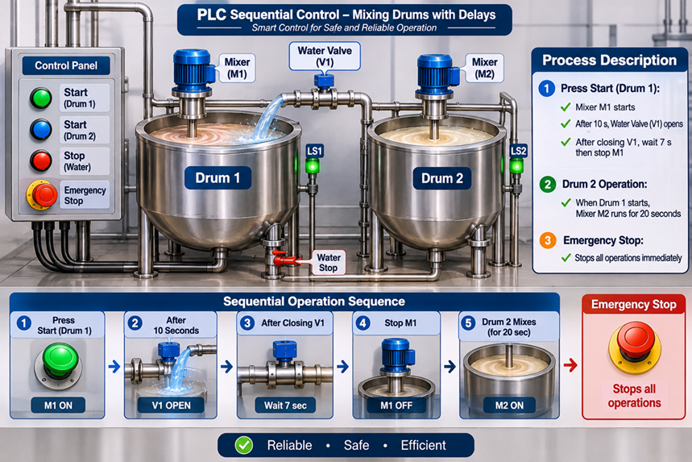
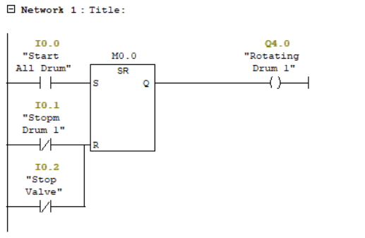
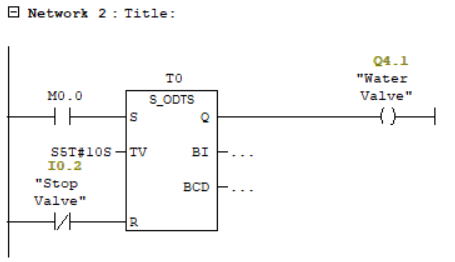
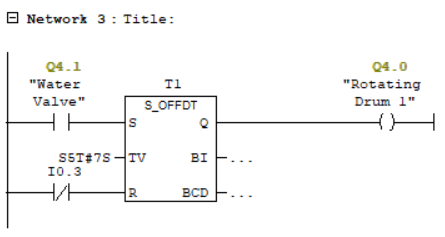
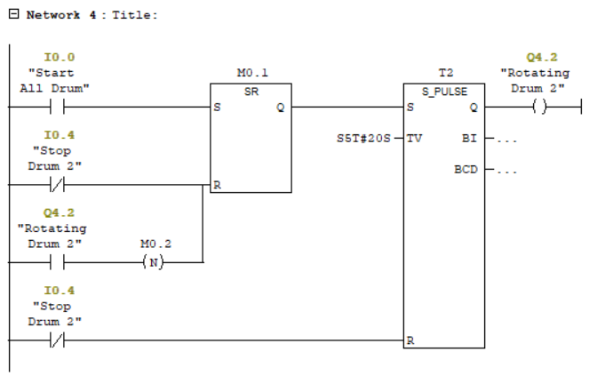

# PLC Sequential Control – Mixing Drums

## Project Overview

This project implements a PLC-based sequential control system for two mixing drums using Siemens S7-300.

The system controls the operation of Drum 1, its water supply valve, and the timed operation of Drum 2. Time-based control functions are implemented using Siemens PLC timers and Ladder Logic (LAD).

The main objective is to achieve a coordinated mixing process with appropriate time delays and stop controls.

## Process Description

### Drum 1 – Main Mixing Process

1. Pressing the Start button activates the rotating motor of Drum 1.
2. After a 10-second delay, the water supply valve opens.
3. When the water valve is stopped, the rotating motor continues running for another 7 seconds.
4. After this delay, the Drum 1 motor stops.

### Drum 2 – Secondary Mixing Process

1. Drum 2 is activated by the same Start command used for Drum 1.
2. Its mixing motor operates for 20 seconds.
3. After the preset time, the motor automatically stops.

### Stop and Reset Controls

The program includes separate stop controls for Drum 1, the water valve, and Drum 2, as well as a reset input for timer T1.

## I/O Assignment

### Digital Inputs

| Address | Description |
|---|---|
| I0.0 | Start All Drum |
| I0.1 | Stop Drum 1 |
| I0.2 | Stop Valve |
| I0.3 | Reset Timer T1 |
| I0.4 | Stop Drum 2 |

### Digital Outputs

| Address | Description |
|---|---|
| Q4.0 | Rotating Drum 1 |
| Q4.1 | Water Valve |
| Q4.2 | Rotating Drum 2 |

## Timer Configuration

| Timer | Function | Preset Time |
|---|---|---|
| T0 | Delayed activation of the water valve | 10 seconds |
| T1 | Delayed shutdown of Drum 1 | 7 seconds |
| T2 | Timed operation of Drum 2 | 20 seconds |

## Ladder Logic (LAD) Networks

The main control program is organized into four networks within OB1.

- **Network 1:** Start and stop control for Drum 1.
- **Network 2:** Delayed activation and stop control of the water valve.
- **Network 3:** Delayed shutdown control of Drum 1.
- **Network 4:** Timed operation and stop control of Drum 2.

## Program Screenshots

The Ladder Logic networks are provided below for reference.

### Network 1 – Drum 1 Start and Stop Control

### Network 2 – Delayed Water Valve Activation

### Network 3 – Delayed Shutdown of Drum 1

### Network 4 – Timed Operation of Drum 2

## Simulation Demo

The project was tested through PLC simulation.

<!-- Add simulation GIF here -->

## Simulation Test Cases

| Test ID | Test Scenario | Expected Result |
|---|---|---|
| TC-01 | Press Start | Drum 1 starts |
| TC-02 | Wait 10 seconds after Start | Water valve opens |
| TC-03 | Stop the water valve | Drum 1 continues running during the 7-second delay |
| TC-04 | Wait 7 seconds after valve shutdown | Drum 1 stops |
| TC-05 | Press Start | Drum 2 starts its timed operation |
| TC-06 | Wait 20 seconds | Drum 2 stops automatically |
| TC-07 | Activate the stop controls | The corresponding controlled operation stops |
| TC-08 | Activate I0.3 | Timer T1 is reset |

## Software and Hardware

- **PLC:** Siemens S7-300
- **CPU:** CPU 314C-2 DP
- **Programming Software:** SIMATIC Manager – STEP 7 V5.7
- **Programming Language:** Ladder Logic (LAD)
- **Program Block:** OB1
- **Testing Environment:** PLC Simulation

## Project Files

- `PLC_Program.pdf` – Exported PLC program.
- `Screenshots/` – Ladder Logic network screenshots.
- `GIFs/` – PLC simulation demonstration.

## Learning Objectives

- Implementing sequential control using Ladder Logic.
- Working with Siemens S7-300 PLCs.
- Applying on-delay and off-delay timer functions.
- Coordinating multiple motors and a water valve.
- Implementing stop and timer reset controls.
- Testing PLC control sequences through simulation.

## Project Status

Completed and tested in a simulation environment.
